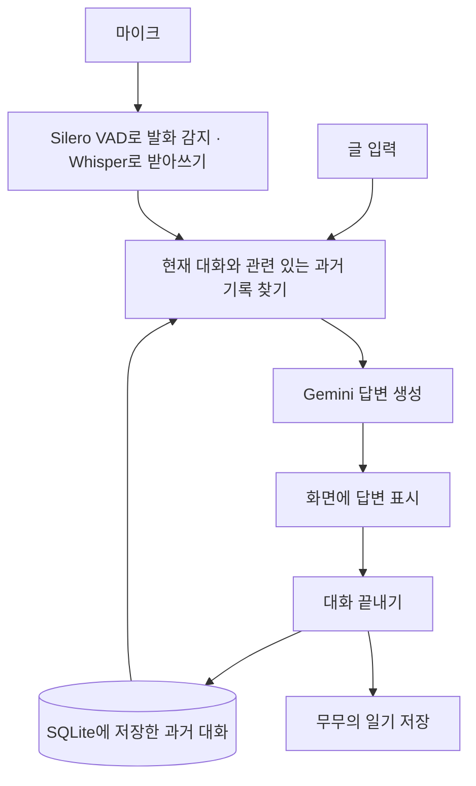

# legacy

해커톤에서 만들었던 MUMU를 다시 개발하며 바뀐 점과 기능을 정리한 문서입니다.

기존 MUMU는 Whisper로 말을 받아쓰고, IBM watsonx로 답변을 만든 뒤 Supertone으로 읽어주는 음성 챗봇이었습니다. 당시 코드와 설명은 아래 링크에서 확인할 수 있습니다.

[MUMU legacy](legacy/README.md)

# MUMU - 대화를 위한 챗봇

무무는 편하게 일상 이야기를 나눌 수 있는 말동무 챗봇입니다. 어린아이처럼 가볍고 다정하게 말하는, 보조, 정보제공, 업무 등이 아닌 "대화"를 위한 챗봇입니다.

개발 과정은 [개발일지](dev-notes/DEV_LOG.md)를 통해 볼 수 있습니다.

## 주요 기능

- 텍스트로 입력하거나 마이크로 직접 말하면서 대화할 수 있습니다.
- 지난 대화 중 지금 이야기와 관련 있는 내용을 찾아 답변에 참고합니다.
- 대화내용은 일기처럼 요약되어 정리되고, 대화 전문 열람을 할 수도 있습니다.

## 사용 흐름

홈에서 **이야기**를 누르면 대화창이 열립니다. 모델을 불러오는 동안에는 중앙에 준비 중 팝업이 뜹니다. 준비가 끝나면 글을 입력하거나 **마이크 켜기**를 눌러 이야기할 수 있습니다. Enter는 전송, Shift+Enter는 줄바꿈입니다.

마이크는 서버를 실행한 PC의 기본 마이크를 사용합니다. 마이크를 켜두면 말소리가 있을 때만 받아씁니다. 무무가 답변하는 동안에는 마이크 입력을 멈추고, 초록 표시등이 다시 켜지면 다음 말을 받습니다. **마이크 끄기**를 누르면 글로 대화를 이어갈 수 있습니다.

**대화 끝내기**를 누르거나 “잘 가”, “나 이제 잘게”라고 말하면 대화와 일기를 저장한 뒤 홈으로 돌아갑니다. 다시 **이야기**를 누르면 새 대화를 시작합니다. 저장에 실패하면 홈에서 다시 저장할 수 있습니다.

**일기장**에서는 날짜를 골라 무무의 일기를 읽을 수 있습니다. 일기 속 ‘나’는 무무입니다. **대화 전문 보기**를 누르면 그때 주고받은 말을 순서대로 볼 수 있습니다.

홈으로 돌아가거나 탭을 닫으면 마이크를 끕니다. 브라우저 연결이 끊겼을 때는 마지막 화면 갱신 후 약 30초 안에 마이크를 해제합니다.

## 대화를 기억하는 방식

현재 대화는 이력을 이어서 Gemini에 보냅니다. 대화를 마치면 원문을 짧은 구간으로 나누고, `intfloat/multilingual-e5-small`로 임베딩해 SQLite에 저장합니다. 임베딩은 PC에서 처리합니다.

다음 대화에서는 사용자가 방금 한 말을 검색어로 삼아 관련 있는 구간을 최대 3개 찾습니다. 찾은 내용이 있으면 Gemini에 함께 보내고, 없으면 현재 대화만으로 답합니다. 대화할 때마다 과거 기록 전체를 보내지는 않습니다.

기록은 `memory_DB/mumu.sqlite3`에 저장됩니다. 브라우저 쿠키가 유지되면 서버를 다시 켜도 같은 기록을 검색할 수 있습니다. 일기는 대화가 끝날 때 따로 생성해 저장합니다. 검색 과정과 기존 방식의 차이는 개발 일지에 더 자세히 적었습니다. [대화 이력과 RAG 비교](dev-notes/DEV_LOG.md#11-레거시-대화-이력과-리버스의-로컬-rag)

## 음성 입력을 바꾼 과정

처음에는 말의 길이와 상관없이 5초씩 녹음했습니다. 짧게 말해도 기다려야 했고, 길게 말하면 뒷부분이 잘렸습니다.

지금은 Silero VAD로 말의 시작과 끝을 감지합니다. 말하기 직전 약 224ms를 함께 보관해 첫 음절이 잘리는 것을 줄이고, 말소리가 800ms 동안 멈추면 Whisper에 넘깁니다. 받아쓰기에 쓰는 기본 모델은 원본 Whisper `small`입니다. 모델은 처음 한 번 불러온 뒤 재사용합니다.

원본 Whisper는 `temperature=0`, `beam_size=5`로 실행합니다.

## Whisper 파인튜닝 실험

짧은 한국어 발화와 끝말잇기에서 단어가 다르게 인식되는 문제를 보고, 원본 `small`에 한국어 데이터를 추가로 학습시켜 봤습니다.

| 실험 | 학습 데이터 | 평가 데이터 | CER 변화 |
|---|---|---|---|
| 첫 파인튜닝 | AI Hub 자유대화 음성 1,079개, 약 2시간 | 학습에 없는 화자의 발화 120개 | 5.55% → 4.18% |
| KsponSpeech 파인튜닝 | 발화 1,812개, 약 2시간 | 별도 eval_clean 발화 120개 | 10.63% → 9.33% |

CER은 문자 오류율입니다. 위 평가에서는 띄어쓰기와 문장부호를 빼고 계산했습니다.

첫 실험은 학습 데이터에 문장 끝 부호가 없었습니다. 마이크로 써보니 의문문에도 물음표가 붙지 않았습니다. 그래서 문장부호가 있는 KsponSpeech로 다시 학습했습니다. 두 번째 실험에서는 물음표 누락이 17/60에서 13/60으로 줄었지만, 물음표를 잘못 붙인 경우는 6/60에서 7/60으로 늘었습니다.

평가 데이터에서는 CER이 낮아졌지만, 실제 무무 대화에서는 원본 `small`이 더 낫다고 판단해 현재 기본 모델로 사용하고 있습니다. 마이크 비교는 수치로 측정하지 않았습니다. 데이터가 적었던 영향인지, 학습 데이터와 실제 발화의 차이 때문인지는 후속 검증이 필요합니다. [실험 과정과 결과](dev-notes/DEV_LOG.md#10-한국어-whisper-small-파인튜닝)

학습 코드는 두 노트북에 정리했습니다. [첫 학습 노트북](notebooks/whisper-finetuning.ipynb) · [KsponSpeech 학습 노트북](notebooks/whisper-ksponspeech.ipynb)

### 같은 녹음으로 비교하기

`evaluate_stt.py`는 같은 WAV를 5초 고정 녹음, Silero 기본 VAD, 무무의 발화 종료 처리에 각각 넣어 비교합니다.

CER, 말이 끝나기 전 입력이 끊긴 횟수, 말을 인식하지 못한 횟수, 무음을 말로 인식한 횟수를 집계합니다. 의문문에서 물음표가 빠진 경우와 잘못 붙은 경우도 셉니다.

대기 시간은 WAV에서 감지한 말끝과 Whisper 처리 시간을 바탕으로 추정합니다. Gemini 응답 시간은 포함하지 않습니다. 원본 모델은 openai-whisper, 파인튜닝 모델은 Transformers로 실행하므로 추론 구현의 차이도 결과에 영향을 줄 수 있습니다.

## 파일 안내

| 파일·폴더 | 내용 |
|---|---|
| `app.py` | 웹 API, 대화·마이크 상태, 종료와 저장 |
| `main.py` | Gemini 연결, 대화 이력, 스트리밍, CLI |
| `voice.py` · `turns.py` | 음성 인식과 발화 시작·종료 감지 |
| `memory.py` | 과거 대화 검색, 임베딩, 기록·일기 저장 |
| `SYSTEMPROMPT.txt` · `MEMORYPROMPT.txt` | 무무의 대화 규칙과 일기 작성 지침 |
| `templates/` · `static/` | 화면과 이미지 |
| `notebooks/` | Whisper 학습 노트북과 데이터 준비 코드 |
| `tests/` | 대화·저장·화면 상태 검사 |
| `dev-notes/` | 개발 일지와 초기 코드 스냅샷 |
| `legacy/` | 기존 저장소의 코드와 문서 |

## 데이터와 API 사용

Whisper와 임베딩 모델은 PC에서 실행합니다. Gemini에는 답변 생성에 필요한 대화 이력과 검색 결과를 보내고, 대화가 끝날 때 일기를 만들기 위해 대화 내용을 한 번 더 보냅니다. Gemini API 요금은 사용하는 계정과 모델에 따라 달라집니다.

실제 API 키, 대화·일기 데이터베이스, 모델 가중치, AI Hub 원본 데이터는 Git에 올리지 않습니다. 학습 노트북은 실행 출력과 기록을 지운 상태로 보관합니다.
