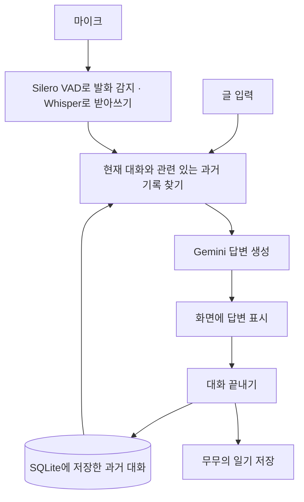
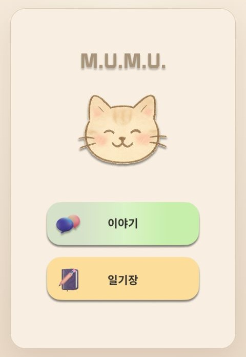
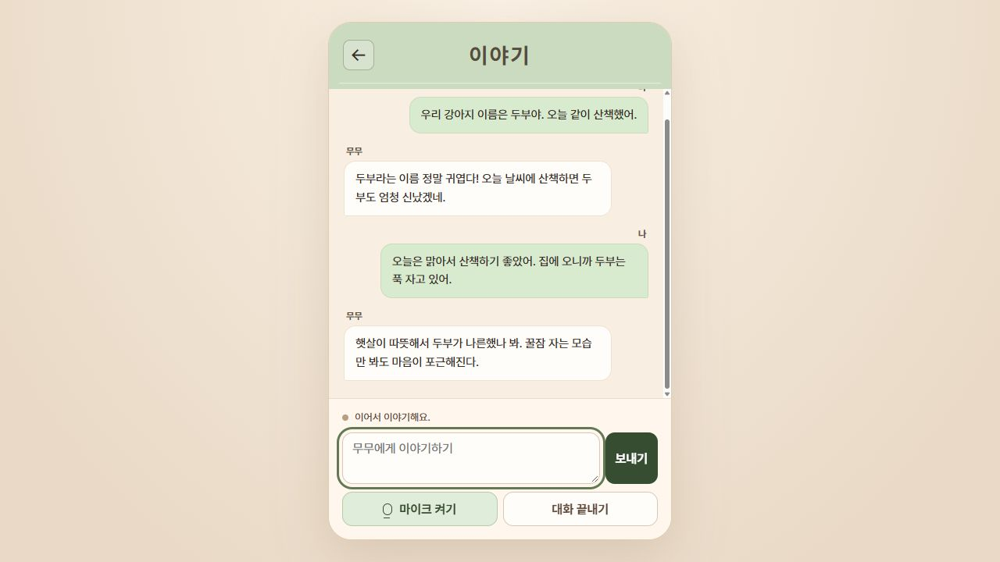
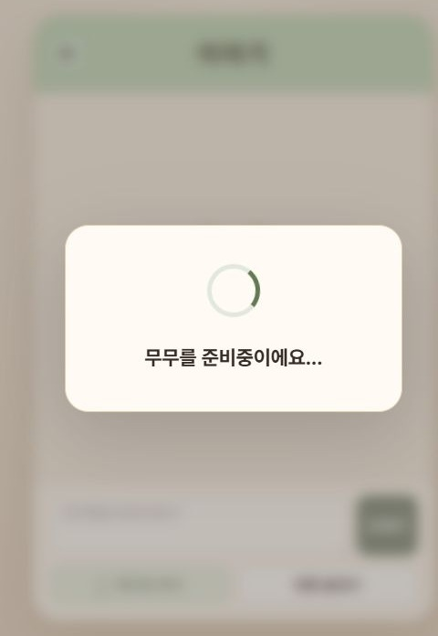
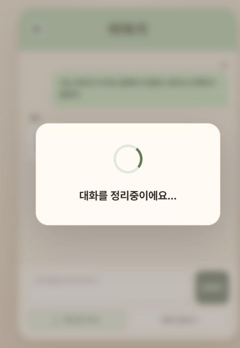
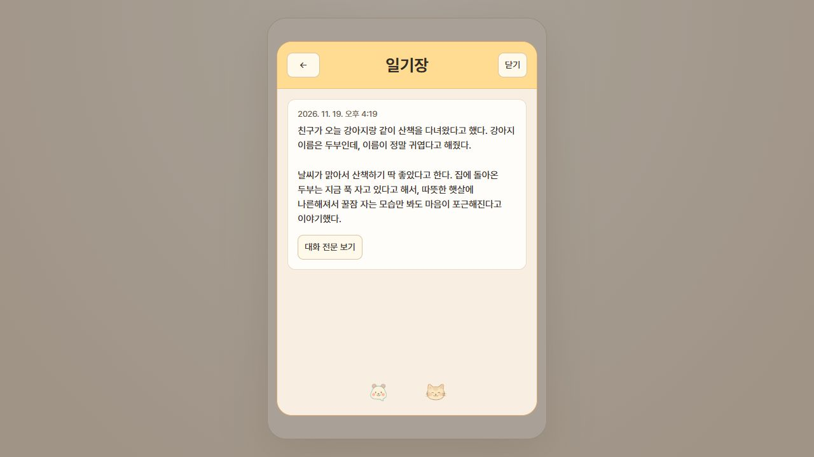
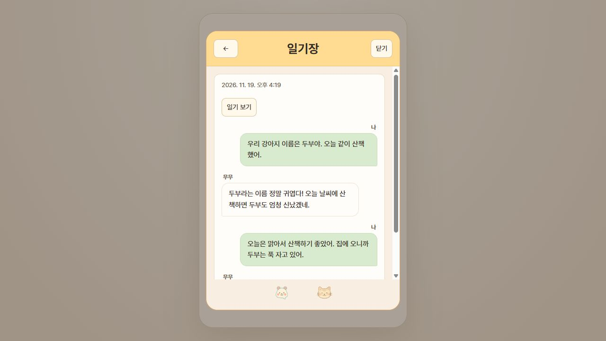

# legacy

이 문서는 해커톤에서 만들었던 MUMU를 다시 개발한 결과와 현재 기능을 소개합니다.

기존 MUMU는 Whisper로 말을 받아쓰고, IBM watsonx로 답변을 만든 뒤 Supertone으로 읽어주는 음성 챗봇이었습니다. 당시 코드와 설명은 아래 링크에서 확인할 수 있습니다.

[MUMU legacy](legacy/README.md)

# MUMU - 대화를 위한 챗봇

## 1. 기획 의도

무무는 편하게 일상 이야기를 나눌 수 있는 말동무 챗봇입니다. 어린아이처럼 가볍고 다정하게 말하는, 보조, 정보제공, 업무 등이 아닌 "대화"를 위한 챗봇입니다.

사용자가 사소한 일상을 이야기해도 앞서 나눈 말을 기억하며 대화를 이어가는 것을 목표로 했습니다. 쉬운 말과 짧은 감정 표현으로 어린이다운 성격을 드러내고, 사용자의 의도와 상황을 이해해 그에 맞게 반응하도록 설계했습니다.

개발 과정은 [개발일지](dev-notes/DEV_LOG.md)를 통해 볼 수 있습니다.

## 2. 구현 방식

화면은 Flask로 만들었습니다. 텍스트 입력과 음성으로 받아쓴 문장을 같은 대화 처리에 넘기고, LangChain을 통해 Gemini의 답변을 받습니다.

| 구성 | 역할 |
|---|---|
| Flask · HTML/CSS/JavaScript | 대화창, 입력 상태, 답변 표시와 일기장 |
| Silero VAD · Whisper small | 말소리의 시작과 끝을 감지하고 한국어로 받아쓰기 |
| LangChain · Gemini | 시스템 프롬프트, 현재 대화 이력과 검색한 기록을 바탕으로 답변 생성 |
| multilingual-e5-small · SQLite | 로컬 임베딩, 과거 대화 검색, 원문과 일기 저장 |

### 대화의 흐름

### 말투와 대화 맥락

무무의 성격과 대화 규칙은 시스템 프롬프트로 전달합니다. 성별이 없는 초등학교 3~4학년 또래의 캐릭터로 설정했고, 가벼운 반응은 한 문장, 설명이 필요하면 보통 두 문장, 길어도 네 문장 안에서 답하도록 했습니다.

답변을 만들 때는 앞선 대화와 사용자가 방금 덧붙인 조건을 함께 보도록 지시합니다. 같은 어려움을 반복해서 이야기하면 짧은 공감에 생각이나 관찰을 보태고, 사용자가 제안을 실행하기 어려운 이유를 말하면 그 조건을 다음 답변에 반영하도록 했습니다. 현재 한국 시각도 매 요청에 함께 전달합니다.

### 음성 입력

마이크를 켜두면 Silero VAD가 말소리를 감지합니다. 말소리가 800ms 동안 멈추면 한 턴으로 보고, 원본 Whisper small이 받아씁니다. 텍스트로 바뀐 문장은 키보드로 입력한 문장과 같은 방식으로 대화 모델에 전달합니다.

답변을 만드는 동안에는 마이크 입력을 잠시 멈춥니다. 다음 말을 받을 준비가 되면 초록 표시등이 켜집니다. 마이크는 서버를 실행한 PC의 기본 입력 장치를 사용합니다.

### 대화를 기억하는 방식

현재 대화는 이력을 이어서 Gemini에 보냅니다. 대화를 마치면 원문을 짧은 구간으로 나누고, `intfloat/multilingual-e5-small`로 임베딩해 SQLite에 저장합니다. 임베딩은 PC에서 처리합니다.

다음 대화에서는 사용자가 방금 한 말을 검색어로 삼아 관련 있는 구간을 최대 3개 찾습니다. 찾은 내용이 있으면 Gemini에 함께 보내고, 없으면 현재 대화만으로 답합니다.

기록은 `memory_DB/mumu.sqlite3`에 저장됩니다. 브라우저 쿠키가 유지되면 서버를 다시 켜도 같은 기록을 검색할 수 있습니다. 일기는 대화가 끝날 때 따로 생성해 저장합니다.

## 3. 기능 설명

- 텍스트로 입력하거나 마이크로 직접 말하면서 대화할 수 있습니다.
- 지난 대화 중 지금 이야기와 관련 있는 내용을 찾아 답변에 참고합니다.
- 대화내용은 일기처럼 요약되어 정리되고, 대화 전문 열람을 할 수도 있습니다.

### 화면

**※ 예시 대화로 캡처한 실제 화면입니다.**

#### 홈

**이야기**와 **일기장**으로 들어갈 수 있습니다. 대화를 마치면 기록을 저장한 뒤 이 화면으로 돌아옵니다.

#### 대화

텍스트나 마이크로 대화합니다. 답변은 도착하는 대로 띄어쓰기 단위로 나타나고, 모두 표시되면 입력창으로 포커스가 돌아옵니다. Enter로 전송하고 Shift+Enter로 줄을 바꿀 수 있습니다.

#### 로딩 팝업

모델을 불러오거나 대화를 정리하는 동안에는 중앙에 로딩 팝업을 띄우고 배경을 흐리게 처리합니다.

<table>
  <tr>
    <th>무무 준비 중</th>
    <th>대화 정리 중</th>
  </tr>
  <tr>
    <td></td>
    <td></td>
  </tr>
</table>

#### 일기

대화가 끝나면 무무가 나눈 이야기를 일기로 정리합니다. 일기장에서는 날짜를 골라 읽을 수 있고, 일기 속 ‘나’는 무무입니다.

#### 대화 전문

일기에서 **대화 전문 보기**를 누르면 그때 주고받은 말을 읽기 전용 말풍선으로 다시 확인할 수 있습니다.

### 데이터 처리

Whisper와 임베딩 모델은 PC에서 실행합니다. Gemini에는 답변 생성에 필요한 대화 이력과 검색 결과를 보내고, 대화가 끝날 때 일기를 만들기 위해 대화 내용을 한 번 더 보냅니다.

실제 API 키, 대화·일기 데이터베이스, 모델 가중치, AI Hub 원본 데이터는 Git에 올리지 않습니다.
