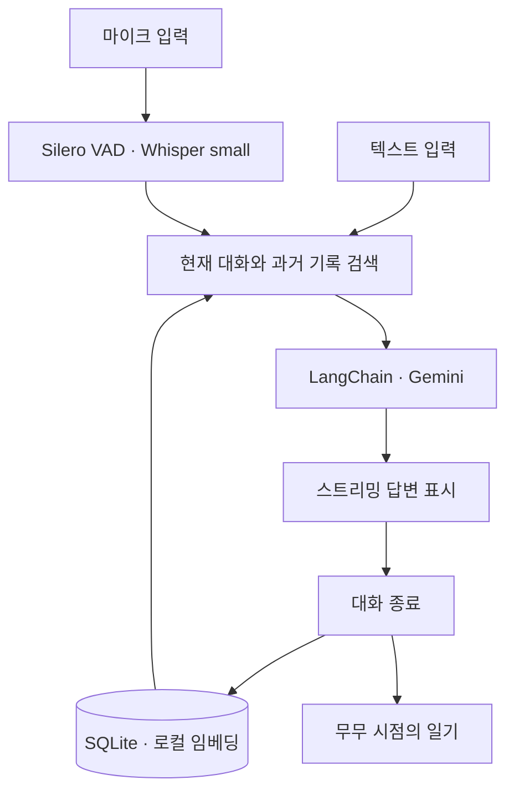

# MUMU - 대화를 위한 챗봇

무성의 어린이 캐릭터 무무와 한국어로 이야기하는 Flask 기반 말동무 애플리케이션입니다. 기존 해커톤 프로젝트를 바탕으로 음성 입력, 대화 이력 관리, 과거 대화 검색과 일기장을 다시 구현했습니다.

## 저장소 리워크

기존 해커톤 코드 정리본은 [legacy/](legacy/README.md)에 보관하고, 현재 실행하는 리버스 코드는 저장소 루트에서 관리합니다. 개발 과정의 초기 초안은 [개발 일지와 스냅샷](dev-notes/DEV_LOG.md)에 남겨두었습니다.

| 항목 | 기존 코드 정리본 | 현재 리버스 |
|---|---|---|
| 대화 모델 | IBM watsonx | LangChain·Gemini |
| 음성 입력 | Whisper 기반 고정 길이 녹음 | Silero VAD로 발화를 나누고 원본 Whisper small로 전사 |
| 대화 이력 | 최근 5개 대화 쌍 | 현재 대화 이력과 관련 있는 과거 대화 구간 검색 |
| 화면 | 코드 정리본에 포함하지 않음 | Flask 대화 화면과 일기장 |
| 기록 | 코드 정리본에 요약·RAG 저장 포함하지 않음 | SQLite에 원문·벡터·일기 저장 |
| 음성 출력 | Supertone TTS 연동 | TTS 보류 |

각 방식의 측정 범위와 해커톤 웹 코드까지 포함한 비교는 [개발 일지](dev-notes/DEV_LOG.md#11-레거시-대화-이력과-리버스의-로컬-rag)에 정리했습니다.

## 주요 기능

- 텍스트 입력과 Silero VAD·로컬 Whisper 기반 음성 입력
- LangChain·Gemini 멀티턴 대화와 스트리밍 답변 표시
- 로컬 임베딩·SQLite 기반 과거 대화 RAG
- 대화 종료 후 무무 시점의 일기 생성과 읽기 전용 대화 전문 열람



## 웹 실행

Python 3.10 이상에서 프로젝트 폴더를 열고 실행합니다.

```powershell
python -m venv .venv
.\.venv\Scripts\python.exe -m pip install -r requirements-web.txt
Copy-Item .env.example .env
```

생성한 `.env`에 `GEMINI_API_KEY` 또는 `GOOGLE_API_KEY`를 넣습니다. 실제 키는 `.env.example`에 작성하지 않습니다. 기본 모델은 `google_genai:gemini-3.5-flash-lite`이며 `MUMU_MODEL`로 변경할 수 있습니다.

```powershell
.\.venv\Scripts\python.exe app.py
```

마이크 사용에는 아래의 **마이크로 대화하기**에 적힌 음성 패키지도 필요합니다. 첫 실행 시 모델 다운로드가 필요합니다. 음성 패키지가 없는 환경에서는 준비 오류가 표시된 뒤 텍스트로 대화할 수 있습니다.

브라우저에서 http://127.0.0.1:5000/ 을 열고 **이야기** 버튼을 누릅니다. 바로 타이핑하거나 **마이크 켜기**를 눌러 말할 수 있습니다. 마이크는 Flask가 실행되는 PC의 기본 입력 장치를 사용하므로 음성 패키지는 위의 마이크 설치 단계를 따릅니다. 발화가 끝나면 전사와 답변 생성이 끝날 때까지 마이크 입력이 일시정지됩니다. 초록 표시등이 다시 켜지면 다음 말을 할 수 있습니다. **마이크 끄기**를 누르면 같은 대화에서 타이핑할 수 있습니다.

대화 화면을 열면 원본 Whisper `small`과 Silero VAD를 백그라운드에서 불러옵니다. 준비 중에는 화면 중앙에 **무무를 준비중이에요...** 로딩 팝업을 표시하고 배경을 흐리게 처리합니다. 팝업이 열린 동안 배경 조작을 차단합니다. 준비된 모델은 Flask 서버가 켜져 있는 동안 재사용하며, 마이크는 **마이크 켜기**를 눌렀을 때 열립니다.

답변 생성 전에는 무무 말풍선에 스켈레톤이 표시됩니다. LangChain의 스트리밍으로 받은 답변은 서버에 임시로 누적하고, 화면이 생성 중에는 약 120ms 간격으로 조회합니다. 화면에서는 띄어쓰기 단위로 약 70ms마다 한 어절씩 표시합니다. 아직 덜 도착한 어절은 공백이나 답변 완료가 확인될 때 표시하며, 줄바꿈과 원문 공백을 유지합니다. 텍스트와 마이크 입력 모두 같은 경로를 사용합니다. 성공적으로 완성된 답변만 대화 이력에 남깁니다.

홈으로 돌아가거나 탭을 닫으면 마이크를 끕니다. 브라우저 연결이 끊기면 마지막 화면 갱신 후 약 30초 안에 마이크가 해제됩니다. 대화 이력은 Flask가 실행 중인 동안 브라우저 세션별로 유지됩니다.

대화 화면에서 **대화 끝내기**를 누르거나 “나 이제 잘게”, “잘 가” 같은 종료 인사를 하면, 대화 원문과 구간별 벡터를 프로젝트의 로컬 SQLite 파일 `memory_DB/mumu.sqlite3`에 저장합니다. LangChain과 `intfloat/multilingual-e5-small`로 PC에서 벡터를 생성합니다. 모델을 처음 불러올 때 가중치를 다운로드해 `.cache/embeddings/`에 보관합니다.

대화를 끝내면 **대화를 정리중이에요...** 로딩 팝업을 표시하고 저장이 끝나면 메인화면으로 돌아갑니다. 다시 홈의 **이야기**를 누르면 새 대화를 시작합니다. 저장 실패 시 홈에 오류와 다시 저장 버튼을 표시합니다.

새 대화에서는 같은 브라우저의 과거 기록 중 현재 발화와 관련된 구간을 최대 3개 찾아 답변에 참고합니다. 브라우저 쿠키가 유지되면 Flask를 다시 실행해도 기록을 검색할 수 있습니다. Gemini를 채팅 모델로 사용하면 검색 결과가 현재 답변의 입력에 포함됩니다.

대화가 끝나면 현재 대화 내용을 채팅 모델에 보내 무무 시점의 일기를 만들고, 원문과 별도로 SQLite에 저장합니다. 홈의 **일기장**에서 날짜를 선택하면 일기 본문이 먼저 표시됩니다. **대화 전문 보기**를 누르면 저장된 발화를 말풍선으로 읽을 수 있습니다. 기존 요약과 이전 버전의 일기는 처음 열 때 무무 시점으로 다듬습니다.

해커톤 버전의 대화 이력 처리와 로컬 RAG의 차이는 [개발 일지의 비교표](dev-notes/DEV_LOG.md#11-레거시-대화-이력과-리버스의-로컬-rag)에 정리했습니다.

## CLI와 STT 실험

### 처음 설정하기

```powershell
python -m venv .venv
.\.venv\Scripts\python.exe -m pip install -r requirements.txt
```

기본 모델은 Gemini 3.5 Flash-Lite입니다. 환경 변수 또는 프로젝트의 `.env`에 `GEMINI_API_KEY`나 `GOOGLE_API_KEY`를 설정하세요. 프로젝트의 `.env`에 키가 있으면 터미널 환경 변수보다 우선합니다.

모델을 바꾸려면 해당 LangChain 연동 패키지를 설치하고 `MUMU_MODEL`에 `제공자:모델명`을 지정하세요.

### 실행하기

```powershell
.\.venv\Scripts\python.exe main.py
```

첫 턴에 좋아하는 음식을 말하고, 다음 턴에 방금 말한 음식이 무엇인지 물어보세요. `/exit`를 입력하면 종료합니다.

### 마이크로 대화하기

PowerShell에서 음성 패키지를 설치합니다. 아래 명령은 CPU로 실행하는 설정입니다.

```powershell
.\.venv\Scripts\python.exe -m pip install torch torchaudio --index-url https://download.pytorch.org/whl/cpu
.\.venv\Scripts\python.exe -m pip install -r requirements-voice.txt
.\.venv\Scripts\python.exe main.py --voice
```

처음 음성 모드를 실행할 때 원본 Whisper `small` 모델을 프로젝트의 `.cache/whisper`에 내려받습니다.
16kHz 모노 마이크 입력을 Silero VAD로 검사하고 발화가 감지될 때만 Whisper로 한국어를 전사합니다. 감지 전 약 224ms를 보관해 첫 음절을 살리고, 말소리가 800ms 동안 멈추면 한 턴을 넘깁니다. 그 전에 다시 말하면 같은 턴으로 이어집니다. 아주 짧은 감지 신호와 빈 전사문은 건너뜁니다.
전사문과 무무의 답변을 터미널에 표시합니다. Whisper는 로컬에서 실행되고, 전사문이 대화 이력과 함께 Gemini로 전송됩니다. 음성 모드는 Ctrl+C로 종료합니다.

중간에 쉬어 말할 때 자주 끊기면 `--silence-ms 1200`으로, 빠른 응답을 원하면 `--silence-ms 400`으로 비교할 수 있습니다. 포트폴리오 수치는 아래 방식으로 평가용 녹음에서 측정합니다.

단어나 이름이 다르게 전사되면 같은 발화를 `--whisper-model base`로 비교할 수 있습니다. 전사할 때 후보 경로 5개를 비교합니다. 원본 모델은 각각 처음 실행할 때 내려받습니다. 문장 중간이 끊기는 경우에는 모델 크기와 별개로 위의 `--silence-ms`를 비교하세요.

```powershell
.\.venv\Scripts\python.exe main.py --voice --whisper-model base
```

KsponSpeech로 학습한 모델을 비교하려면 `mumu-whisper-small-ksponspeech.zip`의 내용물을 `.cache/whisper/mumu-whisper-small-ksponspeech`에 풉니다. 이 경로 바로 아래에 `model.safetensors`와 `config.json`이 있어야 합니다. CLI에서 `--whisper-model ksponspeech`를 지정합니다. 처음 학습한 AI Hub 109번 모델은 `.cache/whisper/mumu-whisper-small`에 두고 `--whisper-model fine-tuned`로 비교할 수 있습니다.

### 한국어 Whisper 파인튜닝

[Colab 학습 노트북](notebooks/whisper-finetuning.ipynb)은 [AI-Hub 자유대화 음성](https://aihub.or.kr/aihubdata/data/view.do?aihubDataSe=data&dataSetSn=109)으로 `openai/whisper-small`을 파인튜닝합니다. AI-Hub에서 받은 샘플을 `New_Sample.zip`으로 내 드라이브 최상위에 두고, Colab에서 GPU를 선택한 뒤 설치 셀부터 실행합니다. 학습 뒤 `/content/mumu-whisper/mumu-whisper-small.zip`에 모델 ZIP이 생성됩니다.

학습에는 3명의 발화 1,079개(2시간)를 사용했습니다. 학습에 포함되지 않은 화자 1명의 발화 120개에서 같은 생성 설정으로 비교한 결과, 글자 오류율(CER)이 **5.55% → 4.18%**로 1.37%p 줄었습니다. 평가 결과는 해당 샘플에 한정되며, 실제 마이크 대화는 별도 평가가 필요합니다. 데이터 분리와 로컬 연결 과정은 [개발 일지](dev-notes/DEV_LOG.md#10-한국어-whisper-small-파인튜닝)에 기록했습니다.

이 실험의 학습·평가 전사에는 물음표가 없었고, CER에서도 문장부호를 제외했습니다. 실제 마이크 테스트에서는 파인튜닝 모델이 기존 `base`에 비해 물음표를 빠뜨린 사례가 있었습니다.

#### KsponSpeech 후속 실험

[KsponSpeech 학습 노트북](notebooks/whisper-ksponspeech.ipynb)은 원본 `openai/whisper-small`에서 시작합니다. [AI Hub 123번](https://aihub.or.kr/aihubdata/data/view.do?dataSetSn=123)의 `KsponSpeech_01.zip`, `KsponSpeech_scripts.zip`, `KsponSpeech_eval.zip`을 같은 폴더 트리에 두고 아래 명령을 실행합니다.

```powershell
.\.venv\Scripts\python.exe notebooks/prepare_ksponspeech.py <AIHub 데이터 폴더> .cache/ksponspeech-colab
```

생성된 ZIP 네 개를 내 드라이브 최상위에 올립니다. T4 GPU가 연결된 Colab에서 Drive 마운트 셀부터 실행하면 공식 학습 split의 2시간 표본으로 학습하고, 별도 `eval_clean` 120개에서 CER과 물음표 오류를 비교합니다. 학습 결과는 내 드라이브의 `MUMU-Whisper-KsponSpeech`에 저장됩니다.

같은 평가 음성에서 원본과 KsponSpeech 모델의 CER은 **10.63% → 9.33%**, 물음표 누락은 **17/60 → 13/60**, 물음표 오삽입은 **6/60 → 7/60**이었습니다.

### STT 비교 평가

비교에 사용할 원본 WAV를 16kHz 모노 PCM16으로 준비합니다. WAV 하나에 의도한 대화 턴 하나를 담고, 녹음 시작 기준으로 실제 발화가 끝난 시각을 ms로 표시합니다. 무음이나 배경 소음만 있는 샘플은 두 칸을 모두 비웁니다. 아래는 CSV 형식의 예시입니다.

```csv
wav,reference,speech_end_ms
short.wav,오늘 산책했어,2050
room-noise.wav,,
```

```powershell
.\.venv\Scripts\python.exe evaluate_stt.py samples.csv --silence-ms 800
```

`--whisper-model`로 같은 평가 파일에 모델을 바꿔 적용할 수 있습니다. 각 실행은 동일한 WAV로 첫 5초 고정 녹음, Silero 기본 VAD 이벤트, 무무의 발화 종료 로직을 비교합니다. 글자 오류율(CER)은 띄어쓰기와 문장부호를 제외해 계산합니다. 조기 종료, 미전사, 무발화 오인식을 집계하고, 정상적으로 끝난 샘플의 대기 시간은 WAV의 감지 시각과 실제 Whisper 처리 시간을 합쳐 추정합니다. 실제 마이크나 Gemini 응답 시간은 이 수치에 포함되지 않습니다. `small`은 openai-whisper, 두 파인튜닝 모델은 Transformers로 실행되므로 이 로컬 비교에는 추론 구현의 차이도 포함됩니다.

문장 끝 물음표를 비교하려면 WAV 한 개에 한 문장씩 담고, 평가 CSV의 모든 의문문 정답을 `?`로 끝냅니다. 의문문과 평서문을 모두 담아 아래 두 명령을 실행하면 기존 CER에 물음표 누락·오삽입 건수가 추가됩니다.

```powershell
.\.venv\Scripts\python.exe evaluate_stt.py samples.csv --whisper-model small --question-metrics
.\.venv\Scripts\python.exe evaluate_stt.py samples.csv --whisper-model ksponspeech --question-metrics
```


## 코드 구성

| 경로 | 역할 |
|---|---|
| `app.py` | Flask API, 세션·마이크 상태, 대화 종료와 저장 |
| `main.py` | Gemini 연결, 멀티턴 이력, 스트리밍, CLI |
| `voice.py` · `turns.py` | Whisper 전사, VAD, 발화 단위 입력 |
| `memory.py` | 로컬 임베딩, SQLite, RAG, 일기 저장 |
| `SYSTEMPROMPT.txt` · `MEMORYPROMPT.txt` | 대화와 일기 생성 지침 |
| `templates/` · `static/` | 대화 화면과 일기장 |
| `notebooks/` | 두 Whisper 파인튜닝 실험과 KsponSpeech 준비 코드 |
| `dev-notes/` | 개발 일지와 초기 코드 스냅샷 |
| `legacy/` | 기존 저장소의 코드와 문서 보관 |

기존 정리본의 실행과 검사는 `legacy/`를 작업 디렉토리로 두고 해당 폴더의 README를 따릅니다.

## 검증

프로젝트 루트에서 실행합니다. 아래 검사는 임시 데이터베이스와 모의 모델을 사용합니다.

```powershell
.\.venv\Scripts\python.exe -m unittest discover -s tests -v
node tests/ui-state.cjs
node --check static/mumu.js
```

실제 마이크 인식률이나 Gemini 응답 품질은 별도 확인이 필요합니다. 개발 과정과 측정 범위는 [개발 일지](dev-notes/DEV_LOG.md)에 정리했습니다.

## 저장 데이터와 외부 호출

`.env`, 실제 대화·일기 데이터베이스, 모델 가중치와 AI Hub 원본 데이터는 Git에서 제외합니다. 모델 가중치는 실행 시 다운로드하거나 각 실험 안내에 따라 준비합니다.

Whisper 전사와 임베딩은 로컬에서 처리합니다. 대화 응답과 일기 생성에는 Gemini API를 사용하며, 관련 전사문·대화 이력·검색 결과가 요청에 포함됩니다. Gemini API 사용량과 요금은 사용하는 계정의 정책을 따릅니다.

TTS는 현재 구현 범위에서 보류한 상태입니다. 두 Whisper 파인튜닝 결과의 평가는 각 실험 데이터에 한정되며, 실제 무무 마이크 대화에서는 원본 `small`을 사용하고 있습니다.
