# MUMU 개선 결과

해커톤에서 개발한 무무와 개선한 무무의 차이를 비교표와 화면으로 정리하였습니다. 입력과 기록 기능을 정리하고, 짧은 답변으로 사용자의 이야기를 이어가는 방향으로 개선하였습니다.

**※ 원활한 테스트 진행을 위해 기존 코드에 기능 버튼들과 키보드 입력을 임시로 추가하였음**

[프로젝트 소개](../README.md) · [MUMU legacy](../legacy/README.md) · [개발일지](../dev-notes/DEV_LOG.md)

동일 입력으로 추가 측정한 응답 시간·토큰·CER·RAG 결과는 [비교 측정 결과](BENCHMARK_RESULTS.md)에 정리하였습니다. 이번 비교용은 Gemini로 교체한 버전으로, 아래의 기존 체감 대기 시간 비교와 조건을 구분하였습니다.

  

## 1. 개선 결과 요약

| 비교 항목 | 기존 | 개선 | 평가 |
|---|---|---|---|
| **평균 답변 대기 시간** | 평균 약 9초 소요 | 평균 약 5초 소요 | LLM 교체 후 응답 대기 시간 감소 관찰: Llama 4 Maverick → Gemini 3.5 Flash-Lite |
| **사용자 입력** | 음성 입력만 지원 | 음성 입력과 키보드 입력 지원 | 사용자의 입력 자유도 확대 |
| **마이크 제어** | 답변 전후로 5초 단위 녹음을 자동 반복 | 마이크 켜기·끄기로 음성 입력을 직접 제어 | 사용자의 마이크 입력 유연성과 제어 범위 확대 |
| **대화 맥락 및 기억 범위** | 현재 대화의 맥락을 파악하나 다른 대화는 기억하지 못함 | 현재 대화의 맥락을 파악하고 다른 대화도 기억하여 답변 | 맥락 파악 수준은 유사하며, 코드 개선으로 기억 활용 최적화 |
| **화제 전환** | 질문으로 답변을 마치며 1~2턴마다 화제를 전환 | 사용자가 꺼낸 주제를 유지하며 화제 전환을 줄임 | 지나친 화제 전환으로 인한 대화의 산만함 예방 |
| **답변 길이** | 공감·조언·후속 질문을 함께 담아 길게 답변 | 질문·공감·격려를 선택적으로 담아 짧게 답변 | 간결한 답변과 토큰 사용량 절감 지향 |
| **대화 진행 방식** | 후속 질문으로 다음 발화를 유도하며 대화를 주도 | 공감과 격려로 발화를 마치며 사용자 주도를 지원 | 사용자 자유도 저하 우려를 줄이고 대화 제어권 부여 |
| **경험 표현** | 자신의 경험담을 적극적으로 덧붙이며 답변 | 자신의 경험담을 제외하고 사용자 상황에 집중 | 실제 경험 없이 생성한 경험담에서 발생하는 모순 방지 |

답변 대기 시간은 실제 사용 중 확인한 대략적인 값으로 기재하였습니다. 동일 조건의 정량 실험으로 모델 교체만의 효과를 분리하거나, 토큰 절감량을 별도로 측정하지는 않았습니다. 대화 방식에 대한 평가는 직접 나눈 대화에서 관찰한 경향을 기준으로 작성하였습니다.

  

## 2. 입력과 마이크 제어

### 대화창 안에서 입력하기

기존 화면에서는 대화 내용과 입력·조작 영역을 나누어 배치하였습니다. 개선 화면에서는 대화창 하단에 텍스트 입력, 마이크 켜기·끄기, 대화 끝내기를 모아 배치하였습니다. 사용자가 입력 방식과 대화 상태를 한 화면에서 확인하도록 구성하였습니다.

<table>
  <tr><th>기존</th><th>개선</th></tr>
  <tr>
    <td valign="top">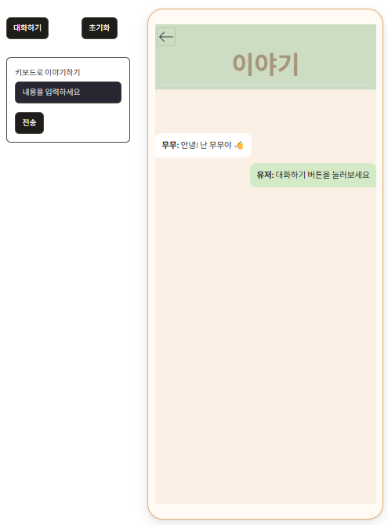</td>
    <td valign="top">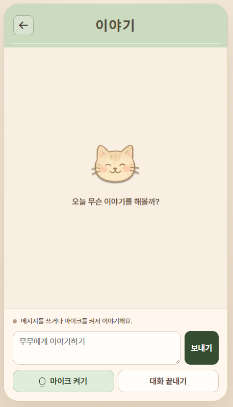</td>
  </tr>
</table>

 

### 말할 준비가 되었는지 확인하기

기존에는 ‘대화하기’를 누른 뒤 5초 녹음을 반복하였습니다. 개선 버전에서는 마이크를 켜면 말소리를 감지하도록 구성하고, ‘듣고 있어요. 편하게 말해 주세요.’ 안내와 초록 표시등으로 입력 대기 상태를 표시하였습니다. 답변 처리 중에는 마이크 입력을 멈추도록 제어하였습니다.

<table>
  <tr><th>기존</th><th>개선</th></tr>
  <tr>
    <td valign="top">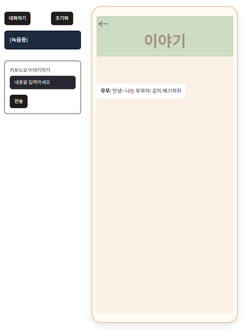</td>
    <td valign="top">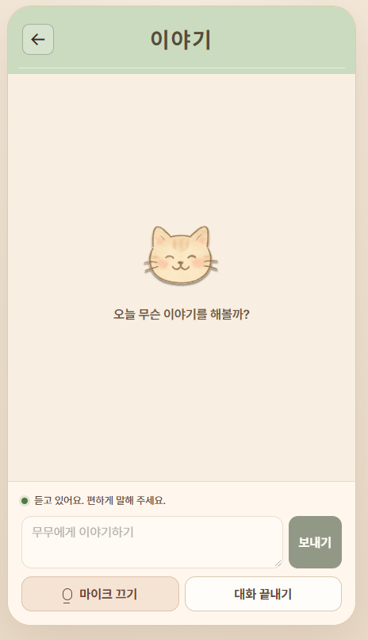</td>
  </tr>
</table>

  

## 3. 대화 방식

### 가볍게 시작하기

같은 ‘안녕?’ 입력에 대해 기존 화면에서는 반가움과 함께 하루를 돌아보는 질문을 연달아 전달하였습니다. 개선 화면에서는 짧은 인사와 현재 상황을 묻는 질문 하나로 대화를 시작하였습니다.

<table>
  <tr><th>기존</th><th>개선</th></tr>
  <tr>
    <td valign="top">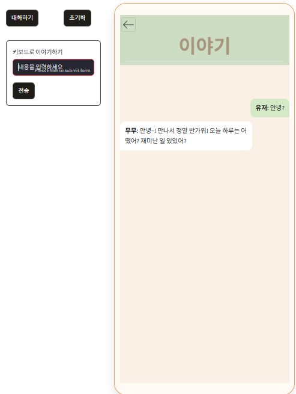</td>
    <td valign="top">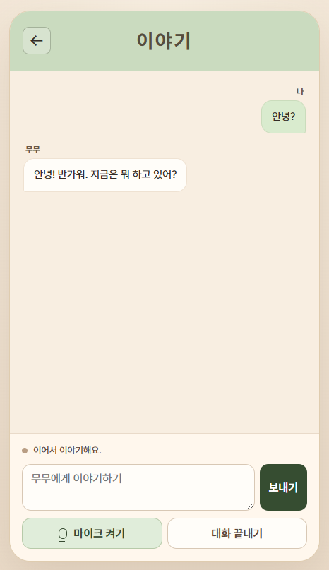</td>
  </tr>
</table>

 

### 사용자가 꺼낸 주제 안에서 이어가기

‘일하다가 잠깐 쉬고 있다’는 상황에서 기존 답변은 긴 공감과 격려에 이어 퇴근 후 할 일이나 저녁 음식으로 화제를 전환하였습니다. 개선 답변은 쉬는 시간과 곧 다시 시작할 일에 집중하여 짧게 반응하였습니다.

이 사례에서는 추가 질문으로 새 화제를 꺼내기보다, 사용자가 알려준 상황을 유지하면서 대화를 이어가도록 조정하였습니다.

<table>
  <tr><th>기존</th><th>개선</th></tr>
  <tr>
    <td valign="top">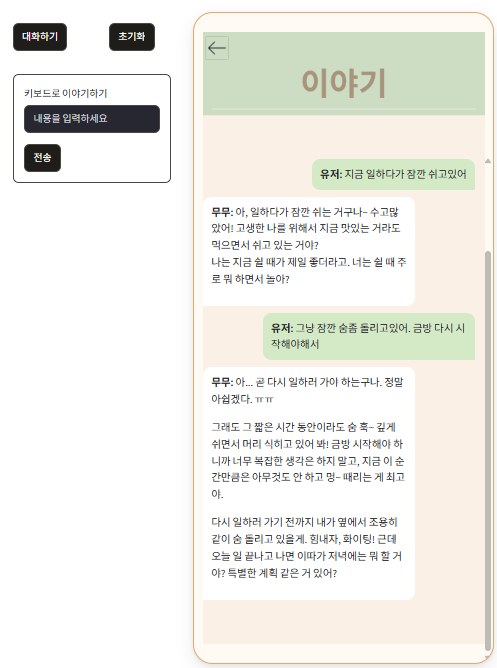</td>
    <td valign="top">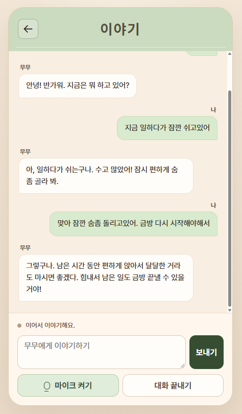</td>
  </tr>
</table>

  

## 4. 일기와 대화 전문 열람

### 나눈 이야기와 반응을 일기로 정리하기

기존에도 대화가 끝나면 일기를 생성하였습니다. 개선 버전에서는 사용자가 말한 상황과 무무의 반응이 함께 드러나도록 정리하고, 날짜와 대화 전문 보기 버튼을 함께 배치하였습니다.

<table>
  <tr><th>기존</th><th>개선</th></tr>
  <tr>
    <td valign="top">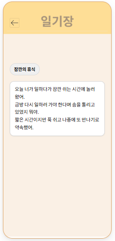</td>
    <td valign="top">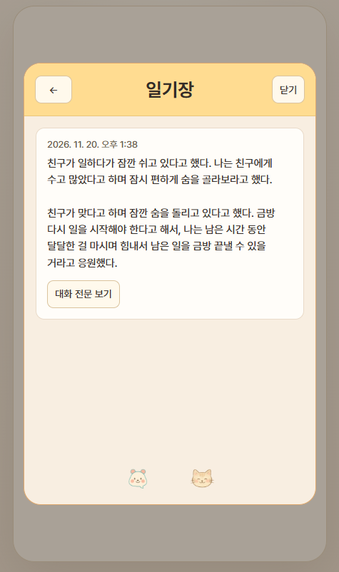</td>
  </tr>
</table>

 

### 일기에서 실제 대화로 이동하기

일기의 ‘대화 전문 보기’를 누르면 해당 대화의 사용자 발화와 무무 답변을 말풍선으로 다시 읽을 수 있도록 구현하였습니다. 열람 화면에서는 입력 없이 저장한 대화만 확인하도록 구성하였습니다.

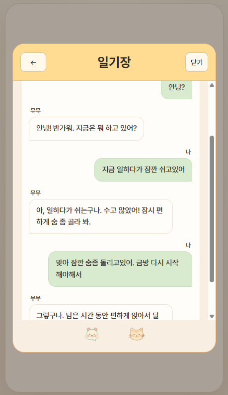

  

## 5. 다음 대화에서도 기록 참고하기

기존에는 현재 대화의 이력을 전달하고, 종료 후 전문과 일기를 텍스트 파일로 저장하였습니다. 개선 버전에서는 대화 전문을 구간별로 임베딩하여 SQLite에 저장하고, 다음 대화에서 현재 발화와 관련 있는 과거 구간을 찾아 답변에 참고하도록 구현하였습니다.

일기는 사용자가 읽는 기록으로, 대화 전문은 열람과 RAG 검색을 위한 기록으로 활용하였습니다. 관련 구간을 최대 3개 검색하여 전달하도록 구성하였습니다.

구현 흐름은 [프로젝트 소개의 ‘대화를 기억하는 방식’](../README.md#대화를-기억하는-방식)에, 개발 과정과 판단은 [개발일지](../dev-notes/DEV_LOG.md)에 정리하였습니다.
