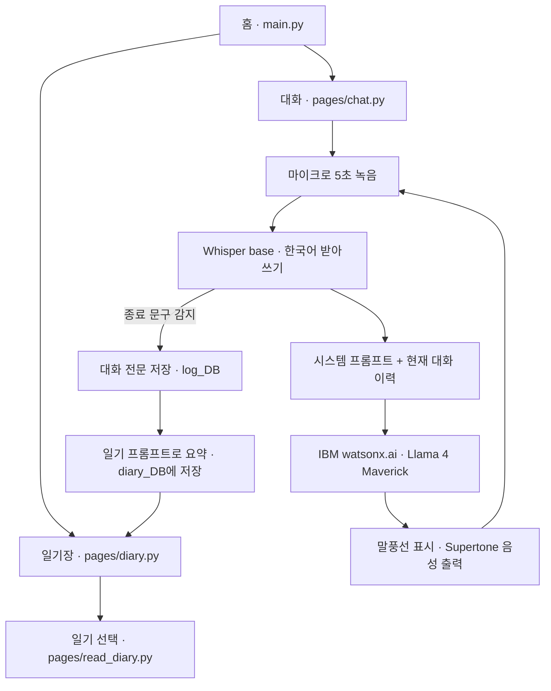

# MUMU legacy

2025 IBM 하계해커톤에서 개발한 무무의 코드와 구현 내용을 정리하였습니다. 로컬에 남아 있던 `IBM-hackathon-program/test` 폴더를 기준으로 작성하였습니다.

**현재 실행 불가: 해커톤에서 지원받았던 IBM watsonx.ai 계정의 이용 기간 만료 및 당시 사용한 Supertone API 서비스 종료**

이후 개선·보완한 무무는 [MUMU](../README.md)에 정리하였습니다.

## 1. 초기 기획 의도

혼자 생활하는 어르신이 일상 이야기를 편하게 나누고, 자신의 경험과 감정을 표현할 수 있는 말벗 서비스를 기획하였습니다. 키보드 입력이 익숙하지 않은 사용자도 이용할 수 있도록 음성을 주요 대화 수단으로 선택하였습니다.

무무는 어린아이처럼 순수하고 다정하게 말하며, 사용자의 이야기에 공감하고 가벼운 질문을 건네도록 설계하였습니다. 대화 이후에도 나눈 이야기를 무무의 일기로 정리하여 다시 읽을 수 있도록 구현하였습니다.

## 2. 구현 방식

Streamlit으로 홈·대화·일기장 화면을 만들고, Whisper와 IBM watsonx.ai, Supertone을 연결하였습니다.

| 구성 | 당시 사용한 방식 |
|---|---|
| 화면 | Streamlit에 HTML·CSS와 이미지 리소스를 적용 |
| 음성 입력 | PyAudio로 16kHz 모노 음성을 5초 단위로 녹음 |
| STT | 로컬 Whisper base로 한국어 받아쓰기 |
| LLM | IBM watsonx.ai의 Llama 4 Maverick으로 답변 생성 |
| TTS | Supertone `sona_speech_1`으로 합성하고 pygame으로 재생 |
| 기록 | 대화 전문과 일기를 각각 로컬 텍스트 파일로 저장 |

## 3. 당시 구현한 기능

### 음성으로 대화하기

홈에서 대화 화면으로 이동한 뒤 ‘대화하기’를 누르면 인사와 함께 음성 대화를 시작하도록 구현하였습니다. 사용자의 말을 받아써 말풍선으로 표시하고, 생성한 답변을 화면과 음성으로 전달하였습니다. 답변 재생이 끝나면 다음 5초 녹음을 시작하도록 구성하였습니다.

‘종료’, ‘잘가’, ‘그만’, ‘나중에 봐’, ‘다음에 더 얘기하자’ 중 하나로 인식되면 대화를 종료하도록 처리하였습니다. 화면에는 대화 이력을 비우는 초기화 버튼도 추가하였습니다.

**현재실행불가**

구현: [pages/chat.py](pages/chat.py) · [음성 콘솔 버전](mumu.py)

### 앞서 나눈 말을 참고하기

시스템 프롬프트에 사용자 발화와 무무의 답변을 순서대로 붙여 다음 답변을 요청하였습니다. 화면 버전과 음성 콘솔 버전 모두 현재 세션에 쌓인 대화 이력을 전달하도록 구성하였습니다.

당시에는 진행 중인 대화 이력만을 문맥으로 전달하였습니다. 저장한 과거 세션을 검색하는 RAG 기능은 이후 개선 과정에서 추가하였습니다.

### 무무의 말투 설정

원본 시스템 프롬프트에는 7~10세 어린아이처럼 다정하게 말하기, 사소한 대화를 이어가기, 한국어 사용, 일정 이야기를 자연스럽게 나누기 등의 지침을 작성하였습니다. 말투와 반응 방식은 별도 학습이 아닌 시스템 프롬프트로 설정하였습니다.

[원본 대화 프롬프트](SYSTEMPROMPT.txt)

### 대화를 일기로 남기기

대화 루프가 끝나면 전문을 `log_DB/log_번호.txt`에 저장하고, 별도의 일기 프롬프트로 전체 대화의 요약을 요청하도록 구현하였습니다. 무무가 ‘나’라는 주체로 3~4문장의 일기를 쓰고, 마지막 줄에 3단어 이하의 제목을 붙이도록 설정하였습니다. 생성 결과는 `diary_DB/diary_번호.txt`에 저장하였습니다.

[원본 일기 프롬프트](DIARYPROMPT.txt) · [일기 생성·저장 코드](pages/chat.py)

### 일기장에서 다시 읽기

저장한 일기를 수정 시각 기준 최신순으로 나열하고, 제목을 눌러 본문을 읽을 수 있도록 구현하였습니다. 마지막 부분의 ‘제목:’ 줄 또는 마지막 비어 있지 않은 줄을 제목으로 사용하였습니다. 대화 전문은 파일로 저장하였으며, 별도의 전문 열람 화면은 미구현 상태로 확인하였습니다.

[일기 목록](pages/diary.py) · [일기 본문](pages/read_diary.py)

## 4. 파일 구성

원본 `test` 폴더에서 홈·음성 대화·일기장에 필요한 파일만 보관하였습니다. 재구성본, 실험용 코드, 별도 텍스트 콘솔 버전과 사용하지 않는 이미지는 제외하였습니다.

| 경로 | 내용 |
|---|---|
| [main.py](main.py) | Streamlit 홈 화면 |
| [mumu.py](mumu.py) | 홈에서 불러오는 모델·음성 처리 코드와 음성 콘솔 대화 |
| [pages/chat.py](pages/chat.py) | 음성 대화, 말풍선 표시, 전문·일기 저장 |
| [pages/diary.py](pages/diary.py) · [pages/read_diary.py](pages/read_diary.py) | 일기 목록과 본문 열람 |
| [SYSTEMPROMPT.txt](SYSTEMPROMPT.txt) · [DIARYPROMPT.txt](DIARYPROMPT.txt) | 당시 대화·일기 프롬프트 |
| [img/](img/) · [pages/img/chat/](pages/img/chat/) | 코드에서 참조하는 화면 이미지 |
| [requirements.txt](requirements.txt) · [.env.example](.env.example) | 필요한 Python 패키지와 환경변수 항목 |
| [원본 코드 설명](docs/CODE_GUIDE.md) | 화면 이동, 음성 처리, 대화 이력과 일기 저장 흐름 |

Python 코드·프롬프트·이미지는 원본 내용 그대로 보관하였습니다. `.env`와 실제 대화·일기 기록은 보관 대상에서 제외하였습니다. `log_DB/`와 `diary_DB/`는 코드에서 생성하도록 구현하였습니다.

## 5. 이후 개선할 부분

| 당시 방식 | 현재 무무 |
|---|---|
| 5초 고정 길이로 녹음 | VAD로 발화의 시작과 끝을 감지 |
| 매 전사 호출에서 Whisper base 로딩 함수 실행 | Whisper small을 미리 준비하고 재사용 |
| 현재 세션 이력을 프롬프트에 직접 연결 | 현재 대화 이력과 함께, 저장한 과거 대화 중 관련 구간을 RAG로 참조 |
| 대화 전문·일기를 텍스트 파일로 보관 | SQLite에 저장하고 일기 및 말풍선 형태의 전문 열람 제공 |
| Streamlit 화면과 watsonx SDK 호출 | Flask 화면과 LangChain을 통한 Gemini 호출 |

개선 과정은 [개발일지](../dev-notes/DEV_LOG.md)에 정리하였습니다.
